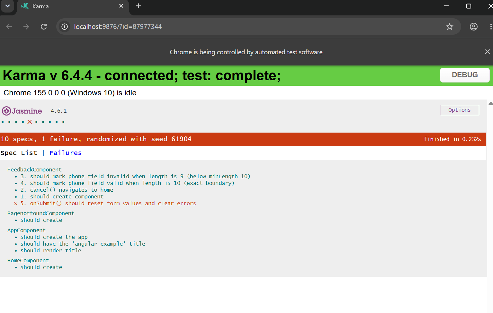
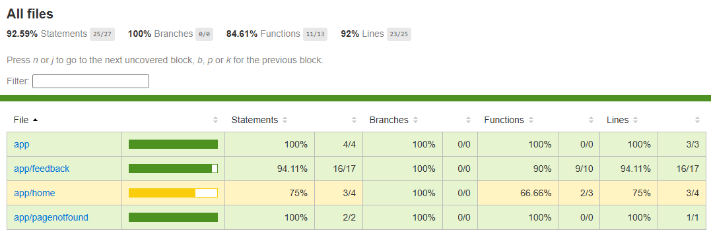

# Yksikkötestausraportti: Angular FeedbackComponent

## 1. Johdanto ja tavoite

Tässä harjoitustyössä tutustuttiin Angular-sovelluksen yksikkötestaukseen hyödyntäen Jasmine- ja Karma-testaustyökaluja. Kohteeksi valittiin `FeedbackComponent` (`src/app/feedback/feedback.component.ts`), jolle laadittiin viisi itsenäistä yksikkötestiä. Testeissä varmistetaan komponentin alustus, reitityslogiikka, lomakkeen nollaus sekä syötekenttien raja-arvojen validointi.

* **GitHub-repositorio:** [https://github.com/mattiansas/angular-example]
* **Testitiedosto:** `src/app/feedback/feedback.component.spec.ts`

---

## 2. Toteutetut yksikkötestit ja niiden tarkoitukset

| Nro   | Testitapaus (`it`)                                        | Testattava kohde     | Tarkoitus ja raja-arvot                                                                                                                      | Tulos    |
| :---- | :-------------------------------------------------------- | :------------------- | :------------------------------------------------------------------------------------------------------------------------------------------- | :------- |
| **1** | `1. should create component`                              | Komponentin alustus  | Varmistaa, että `FeedbackComponent` alustuu onnistuneesti testikontekstiin (`TestBed`).                                                      | **Pass** |
| **2** | `2. cancel() navigates to home`                           | `cancel()`-metodi    | Varmistaa spy-olion avulla, että peruutustoiminto ohjaa käyttäjän reittiin `['home']`.                                                       | **Pass** |
| **3** | `3. should mark phone field invalid when length is 9`     | `phone`-lomakekenttä | **Alaraja-arvo:** Testataan pituutta 9 numeroa (minimivaatimus 10 numeroa). Varmistaa, että kenttä asettaa virheen `minlength: true`.        | **Pass** |
| **4** | `4. should mark phone field valid when length is 10`      | `phone`-lomakekenttä | **Hyväksytty raja-arvo:** Testataan tarkalleen raja-arvoa 10 numeroa. Varmistaa, että kenttä on kelvollinen eikä `minlength`-virhettä synny. | **Pass** |
| **5** | `5. onSubmit() should reset form values and clear errors` | `onSubmit()`-metodi  | Varmistaa lomakkeen nollausmetodin toiminnan. Metodikutsu nollaa kenttien arvot tilaan `null` ja palauttaa lomakkeen oletustilaan.           | **Pass** |

---

## 3. Testien suoritus ja tulokset

Testit ajettiin komennolla:

```bash
ng test --no-watch --code-coverage
```

Kaikki testit suoritettiin onnistuneesti ilman virheitä.

### Testien ajotulokset



*(Kuva testiajosta: tallennettu polkuun `screenshots/test-results.png`)*

---

## 4. Testikattavuus (Code Coverage)

Testikattavuus generoitiin Karman kautta HTML-raportiksi kansioon `coverage/`. Testattavan komponentin (`app/feedback`) koodikattavuudeksi saavutettiin erinomaiset lukemat:

* **Statements:** 94.11 %
* **Branches:** 100 %
* **Functions:** 90 %
* **Lines:** 94.11 %

### Kattavuusraportti



*(Kuva kattavuudesta: tallennettu polkuun `screenshots/coverage-report.png`)*

---

## 5. Yhteenveto

Toteutetut yksikkötestit kattavat komponentin keskeiset toiminnallisuudet ja syöterajat selkeästi ja toistettavasti. Testit parantavat koodin ylläpidettävyyttä ja varmistavat virheettömän toiminnan mahdollisten jatkokehitystoimenpiteiden yhteydessä.